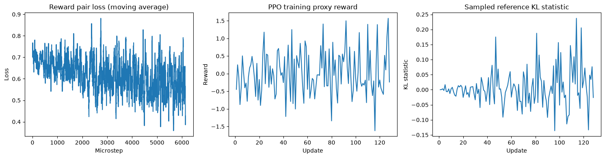

# RLHF with PPO on a 135M Model: A Small, Reproducible Pipeline

[](https://colab.research.google.com/github/MaaadSpike/rlhf-ppo-smollm2/blob/main/notebooks/rlhf_ppo_colab.ipynb)

An end-to-end RLHF reproduction that fits on a single Colab GPU:

**public human preference data → SFT on chosen responses → Bradley–Terry reward model → KL-regularized PPO with LoRA → held-out evaluation**

- **Model:** [`HuggingFaceTB/SmolLM2-135M-Instruct`](https://huggingface.co/HuggingFaceTB/SmolLM2-135M-Instruct) (policy and reward model are trained separately from the same base)
- **Data:** [`Anthropic/hh-rlhf`](https://huggingface.co/datasets/Anthropic/hh-rlhf), `helpful-base` split (existing human comparisons; no new labels collected)
- **Trainer:** TRL 0.11.4 classic `PPOTrainer`, PEFT LoRA (r=8, `q_proj`/`v_proj`)
- **Compute:** one run on a Colab A100; PPO peak allocated memory was **1.3 GiB**, so a T4 is sufficient

The notebook is committed **with the outputs of a full run** (`extended` profile, seed 42), so every number below can be checked against the cell outputs.

---

## Pipeline

| Stage | What it does | Size (`extended`) |
|---|---|---|
| Data | Stream `helpful-base`, parse multi-turn dialogs into chat-template messages, dedupe by full-prompt SHA-256 **before** truncation, then re-check for token-level collisions across splits | 4,096 RM train / 512 RM val / 1,024 PPO prompts / 512 test pairs |
| SFT | LoRA on the chosen responses only (prompt tokens masked to `-100`), then merge into a frozen reference | 2,048 examples, 1 epoch |
| Reward model | Separate LoRA + scalar head on the original base; loss `softplus(-(r_chosen - r_rejected))` + small score L2; checkpoint selected by **validation** pair loss | 3 epochs |
| PPO | New LoRA + value head on the merged SFT base; reference = SFT weights (adapter disabled); fixed KL coef 0.1; reward normalized with validation-set mean/std and clipped to ±5 | 128 updates × 4 prompts |
| Evaluation | RM pair accuracy on held-out test pairs (Wilson CI); SFT vs. PPO generations on 96 held-out prompts with per-prompt fixed seeds; paired bootstrap CI on reward delta | — |

## Results



### Reward model

| Split | Pair accuracy | 95% CI | Pair loss |
|---|---|---|---|
| Val, epoch 1 | 0.652 | [0.610, 0.692] | 0.627 |
| Val, epoch 2 (**selected**) | 0.672 | [0.630, 0.711] | **0.607** |
| Val, epoch 3 | 0.678 | [0.636, 0.717] | 0.626 |
| **Test (held-out)** | **0.695** | **[0.654, 0.734]** | 0.588 |

The reward model learns a real preference signal: held-out accuracy is ~70% and the CI is well above 50%. Epoch 3 has slightly higher validation accuracy but worse loss (score scale growing), so the epoch-2 checkpoint was kept.

### PPO (SFT → PPO, 96 held-out prompts)

| | SFT | PPO |
|---|---|---|
| Mean proxy reward | −0.1466 | −0.1439 |
| Mean response length (tokens) | 30.2 | 31.6 |

Paired reward delta 95% bootstrap CI: **[−0.159, +0.162]**.

**PPO produced no measurable change in this run.** Supporting evidence from the logs:

- The delta CI is centered at ~0 and spans both signs.
- Training-time proxy reward shows no trend (quarter-by-quarter means: −0.065, 0.015, 0.122, −0.017).
- The sampled KL statistic stays near zero and is negative in ~48% of updates, i.e. it is dominated by sampling noise rather than real divergence from the reference.
- Under identical per-prompt seeds, 4 of the 5 test examples displayed in the notebook produce the *exact same* response before and after PPO.

Likely causes (not yet tested individually): a conservative learning rate (1e-5) on a freshly initialized LoRA (whose output starts at exactly zero), only 512 rollouts in total, and batch size 4, which makes advantage estimates very noisy. I report this as a null result rather than tuning against the test set.

## Implementation notes

- **Reward-model pooling bug and fix.** SmolLM2 uses `<|im_end|>` as both EOS and pad, and the chat template places `<|im_end|>` inside every prompt. In transformers 4.45, `*ForSequenceClassification` pools at the token before the *first* pad id, which would land inside the prompt, so chosen and rejected responses would receive identical scores. The notebook left-pads reward-model inputs (with explicit `position_ids`) and sets the model's `pad_token_id = -1` so pooling falls on the true last token. A sanity check asserts that chosen/rejected scores differ before and after training.
- **Leakage controls.** Splits are disjoint at both the full-prompt-hash and the truncated-token level (asserted in code). The test set is only touched in the final evaluation cell.
- **Gradient accumulation** correctly normalizes the last, possibly shorter, accumulation group.
- **Sampling** uses temperature 1 with no top-k/top-p so rollout and training distributions match.

## Reproduce

1. Open the notebook in Colab (badge above) and choose a GPU runtime with **Python 3.12** (runtime version 2026.07). Python 3.13 is not supported by the pinned NumPy 1.26.4.
2. Run the install cell, then **Runtime → Restart session**, then continue from the environment-check cell.
3. Set `PROFILE = 'small'` for a quick pipeline check or `'extended'` for the configuration reported above.
4. The last cells export configs, metrics, LoRA adapters, samples, figures and a blinded A/B review sheet as a zip.

No API keys are needed. Pinned dependencies are in [`requirements.txt`](requirements.txt); the CUDA build of PyTorch comes from the Colab image.

## Repository layout

```
notebooks/rlhf_ppo_colab.ipynb   full pipeline, with outputs from the reported run
results/run_summary.json         numbers reported above, copied from the notebook outputs
assets/training_curves.png       RM loss, PPO reward, and KL statistic
requirements.txt                 pinned versions
```

## Limitations

- Single seed, small samples; no robustness claim across seeds.
- The same learned reward model scores the policy, so a reward gain would be a proxy, not evidence of human preference. Human A/B labels were not collected (the blinded sheet is exported but unfilled).
- 96-token truncation drops context and can affect preference labels; HH-RLHF `chosen` reflects comparative preference, not factual correctness.
- Uses library trainers; this is not an independent PPO implementation or a production-scale RLHF system.

## Next steps

- Sweep PPO learning rate and rollout budget (with a fresh held-out split) to find the regime where the policy actually moves.
- Add a "no-PPO" control run and multiple seeds.
- Fill in the blinded human A/B review.

## License

Code: MIT (see [LICENSE](LICENSE)). SmolLM2 is released under Apache 2.0 and Anthropic HH-RLHF under MIT; see their respective pages.

## References

- Bai et al., 2022. *Training a Helpful and Harmless Assistant with Reinforcement Learning from Human Feedback.*
- Ouyang et al., 2022. *Training language models to follow instructions with human feedback.*
- [TRL v0.11.4 PPOTrainer docs](https://huggingface.co/docs/trl/v0.11.4/ppo_trainer)
